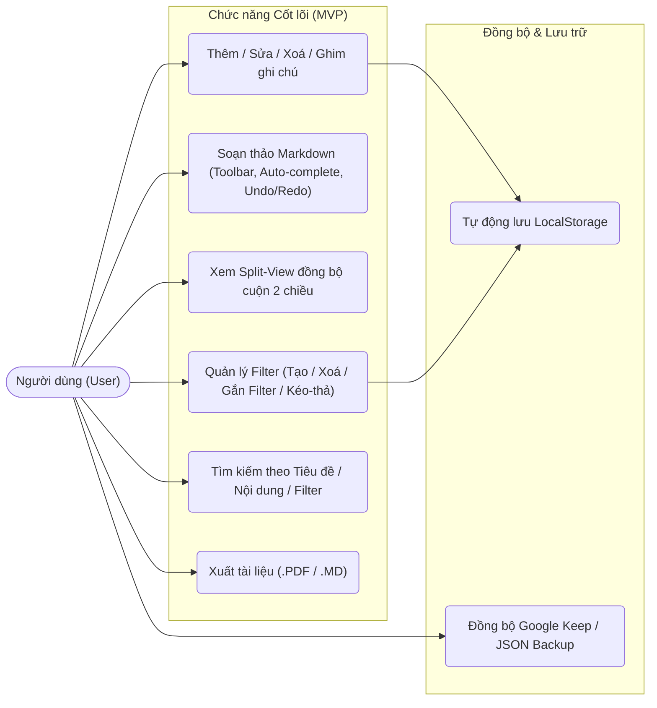
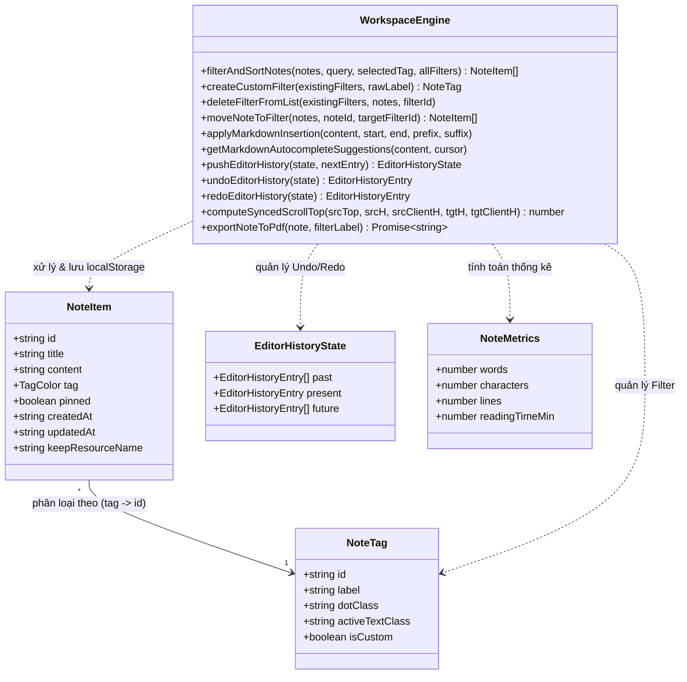

# VibeNotes — Không gian Ghi chú Kỹ thuật Markdown & Đồng bộ Google Keep

## 1. Mở đầu: Vấn đề Thực tế Cần Giải quyết (Problem Statement)

Trong công việc kỹ thuật và học tập hàng ngày, người dùng thường gặp sự phân mảnh lớn giữa hai nhóm công cụ ghi chú:
1. **Các ứng dụng ghi chú nhanh (như Google Keep, Sticky Notes)**: Mở nhanh, nhẹ, nhưng **không hỗ trợ Markdown**, không thể viết bảng biểu, checklist kỹ thuật, khối mã (`code block`), và không xuất được tài liệu PDF chỉn chu để chia sẻ.
2. **Các nền tảng quản lý tri thức đồ sộ (như Notion, Obsidian)**: Hỗ trợ Markdown mạnh mẽ nhưng thời gian khởi động chậm, giao diện nhiều tầng phức tạp, hoặc đòi hỏi cài đặt phần mềm/đồng bộ đám mây bắt buộc trước khi có thể gõ dòng đầu tiên.

**VibeNotes** được xây dựng như một **Mini-App Workspace chuyên biệt (Local-First Markdown & Keep Studio)** nhằm giải quyết bài toán thực tế đó:
- Mở trình duyệt là viết ngay lập tức với **độ trễ lưu trữ `0ms`** vào `localStorage`.
- Hỗ trợ soạn thảo Markdown tốc độ cao nhờ **thanh công cụ định dạng nổi (Floating Toolbar)** tích hợp **Undo / Redo**, **gợi ý cú pháp thông minh theo vị trí con trỏ (`/`, `#`, `-`, `>`)**, và **chế độ xem song song (Split View) đồng bộ cuộn hai chiều** giữa khung soạn thảo và khung xem trước.
- Tổ chức ghi chú linh hoạt bằng **Filter tùy chỉnh (tạo/xoá/kéo-thả)**, tìm kiếm tức thì theo **Tiêu đề / Nội dung / Filter**, xuất file **`.pdf` chuẩn A4** hoặc **`.md`**, và kết nối với **Google Keep** khi cần đồng bộ nhanh.

---

## 2. Mô tả Yêu cầu, Phạm vi Tối thiểu (MVP) & Sơ đồ Thiết kế

### 2.1. Lý do Chọn Phạm vi MVP (Scope Justification)
Với quỹ thời gian phát triển **1 tuần**, thay vì dàn trải vào hệ thống tài khoản backend riêng, chia sẻ thời gian thực nhiều người dùng (multi-user collaboration) hay quản lý thư mục đa cấp phức tạp, dự án tập trung tối đa vào **độ ổn định và trải nghiệm cốt lõi của cá nhân khi viết & tra cứu ghi chú**:
- **Ưu tiên 1 (Core CRUD & Persistence)**: Thêm, đọc, sửa, xoá ghi chú và tự động lưu `localStorage` an toàn 100%.
- **Ưu tiên 2 (Trải nghiệm Soạn thảo Markdown)**: Thanh công cụ nhanh, Undo/Redo (nút bấm & phím tắt `Ctrl/⌘+Z`, `Ctrl+Y`), gợi ý cú pháp tự động (Auto-complete), và Split-view có đồng bộ cuộn hai chiều.
- **Ưu tiên 3 (Phân loại & Tìm kiếm)**: Tạo/xoá Filter động (trừ `All`), gắn filter bằng 1 cú nhấp hoặc kéo-thả, tìm kiếm tức thì theo `Tiêu đề / Nội dung / Filter`.
- **Ưu tiên 4 (Trích xuất & Đồng bộ)**: Xuất file `.md`, xuất file `.pdf` định dạng A4, và tích hợp Google Keep kèm cơ chế Import/Export JSON dự phòng.

---

### 2.2. Sơ đồ Use Case Cốt lõi



---

### 2.3. Sơ đồ Lớp & Thực thể Dữ liệu (Class / ERD Diagram)



---

## 3. Đối chiếu giữa "Mục tiêu" và "Kết quả Đạt được"

| Hạng mục | Mục tiêu ban đầu (1 tuần) | Kết quả đạt được | Trạng thái |
| :--- | :--- | :--- | :--- |
| **Quản lý Ghi chú (CRUD)** | Thêm, xem, sửa, xoá (có xác nhận), ghim ghi chú ưu tiên lên đầu. | Hoạt động ổn định, phản hồi tức thì, có hộp thoại xác nhận trước khi xoá. | **Hoàn thành 100%** |
| **Lưu trữ Cục bộ (`localStorage`)** | Tự động lưu ghi chú, danh sách filter và giao diện Sáng/Tối khi reload trang. | Tự động lưu với độ trễ `0ms` trên từng thao tác gõ phím. | **Hoàn thành 100%** |
| **Trình soạn thảo Markdown & Undo/Redo** | Hỗ trợ Markdown, thanh công cụ nổi, gợi ý cú pháp tự động (`/`, `#`, `-`, `>`), Undo/Redo. | Đầy đủ Floating Toolbar, Auto-complete theo con trỏ, Undo/Redo bằng nút bấm & phím tắt (`⌘Z`/`Ctrl+Z`, `⌘⇧Z`/`Ctrl+Y`). | **Hoàn thành 100%** |
| **Chế độ Xem & Đồng bộ Cuộn** | Chuyển đổi `Edit` / `Split` / `Preview`, cuộn bên nào bên kia tự cuộn theo. | Đồng bộ cuộn hai chiều theo tỷ lệ phần trăm kèm khoá chống lặp sự kiện (`Anti-bounce Lock`). | **Hoàn thành 100%** |
| **Hệ thống Filter & Tìm kiếm** | Tạo mới filter, xoá filter (trừ `All`), gắn filter nhanh, tìm theo Tiêu đề/Nội dung/Filter. | Hỗ trợ chọn filter bằng dropdown 1 chạm hoặc kéo-thả, tìm kiếm kết hợp cả 3 trường. | **Hoàn thành 100%** |
| **Xuất File (Export)** | Xuất ghi chú ra file `.md` và `.pdf` rõ nét, không lỗi font tiếng Việt. | Hỗ trợ cả `Export Markdown` và `Export PDF` chuẩn khổ A4 nhiều trang. | **Hoàn thành 100%** |
| **Đồng bộ Đám mây** | Kết nối Google Keep API + cơ chế sao lưu JSON. | Tích hợp Firebase Google OAuth + Keep REST API kèm công cụ Import/Export JSON. | **Hoàn thành 100%** |
| **Cộng tác thời gian thực (Multi-user)** | Nhiều người cùng sửa 1 ghi chú qua WebSocket. | Chưa thực hiện để tập trung độ ổn định cho Local-First MVP trong 1 tuần. | **Ngoài phạm vi (Out of Scope)** |
| **Cây thư mục lồng nhau đa cấp** | Thư mục con nhiều tầng (Sub-folders). | Giữ mô hình Filter phẳng để thao tác 1 chạm nhanh và gọn. | **Ngoài phạm vi (Out of Scope)** |
| **Đính kèm file nhị phân dung lượng lớn** | Upload video/file đính kèm nặng hàng chục MB. | Không phù hợp với giới hạn dung lượng ~5MB của `localStorage`. | **Ngoài phạm vi (Out of Scope)** |

---

## 4. Quản trị Rủi ro & Hành động Ứng phó (Risk Management)

Trong quá trình phát triển dự án trong 1 tuần, 3 rủi ro kỹ thuật và phạm vi đã được nhận diện sớm kèm giải pháp ứng phó dứt điểm:

### Rủi ro 1: Scope Creep & Mất lịch sử Undo mặc định khi thao tác trên `<textarea>` có điều khiển (Controlled Textarea)
- **Vấn đề**: Việc tích hợp các thư viện editor đồ sộ (Monaco/ProseMirror) dễ gây xung đột state và tăng kích thước bundle; trong khi nếu dùng `<textarea>` có điều khiển bởi React state thì khi chèn cú pháp từ thanh công cụ, lịch sử Undo mặc định của trình duyệt sẽ bị xoá.
- **Hành động ứng phó**: Giữ kiến trúc `<textarea>` gốc kết hợp thư viện **`marked`**, đồng thời xây dựng ngăn xếp lịch sử **`EditorHistoryState` (`pushEditorHistory`, `undoEditorHistory`, `redoEditorHistory`)** trong `notesLogic.ts`. Nhờ đó vừa nhẹ, vừa hỗ trợ Undo/Redo chính xác cho cả gõ phím, thanh công cụ nổi lẫn gợi ý Auto-complete.

### Rủi ro 2: Lỗi mất dấu Tiếng Việt khi xuất PDF bằng font mặc định của `jsPDF`
- **Vấn đề**: Phương thức `pdf.text()` mặc định của `jsPDF` chỉ hỗ trợ bảng mã ASCII chuẩn, dẫn đến lỗi hiển thị ký tự tiếng Việt có dấu và mất định dạng bảng biểu/code block của Markdown.
- **Hành động ứng phó**: Kết hợp **`html2canvas` + `jsPDF`** trong `src/utils/pdfExport.ts` để dựng trang tài liệu A4 chuẩn Editorial ở độ phân giải cao (`scale: 2`), sau đó phân trang tự động sang PDF, đồng thời giữ một nhánh fallback văn bản thuần khi môi trường hạn chế canvas. Giải pháp giúp giữ nguyên 100% tiếng Việt có dấu và định dạng Markdown.

### Rủi ro 3: Giới hạn quyền Enterprise của Google Keep REST API đối với Gmail cá nhân
- **Vấn đề**: Scope `https://www.googleapis.com/auth/keep` của Google chỉ cấp phép mặc định cho các miền Google Workspace Enterprise, nên tài khoản `@gmail.com` cá nhân có thể bị từ chối cấp token trực tiếp.
- **Hành động ứng phó**: Thiết kế kiến trúc **Hybrid Sync** trong `GoogleKeepDrawer.tsx` — vừa hỗ trợ kết nối trực tiếp Google Keep REST API cho tài khoản Workspace, vừa bổ sung tính năng **Import / Export Keep JSON Snapshot** ngay trong ngăn kéo đồng bộ để mọi người dùng đều sao lưu và chuyển đổi dữ liệu trơn tru.

---

## 5. Tự Đánh giá (Self-Evaluation), Lessons Learned & Future Work

### 5.1. Tự Đánh giá Ngắn
- **Điểm mạnh**:
  - **Kiến trúc tách biệt & Kiểm thử đầy đủ**: Toàn bộ logic cốt lõi (tìm kiếm đa trường, lọc, thống kê từ, chèn Markdown, gợi ý cú pháp, ngăn xếp Undo/Redo, tính toán vị trí cuộn đồng bộ, chuẩn hoá tên file PDF) được tách thành pure functions trong `src/utils/notesLogic.ts` và được kiểm thử tự động trong thư mục **`/tests`** (gồm cả **Unit Tests**, **Integration Tests** và tài liệu **Manual Test Cases**).
  - **Trải nghiệm UX/UI nhất quán**: Thiết kế phong cách Editorial tối giản, hỗ trợ đầy đủ phím tắt (`⌘K`, `⌘B`, `⌘I`, `⌘Z`, `⌘⇧Z`/`Ctrl+Y`), đồng bộ cuộn hai chiều mượt mà ở chế độ Split và xử lý an toàn khi xoá filter (tự động chuyển ghi chú sang filter còn lại thay vì làm mất ghi chú).
- **Điểm yếu**:
  - Dung lượng lưu trữ của `localStorage` giới hạn ở mức khoảng `5MB`, chưa phù hợp nếu người dùng lưu hàng nghìn ghi chú dài kèm ảnh base64.
  - Đồng bộ cuộn hai chiều hiện tính theo tỷ lệ phần trăm chiều cao tổng thể (`scrollTop / maxScroll`), có thể lệch nhẹ vài dòng nếu ghi chú chứa một bảng hoặc khối mã quá dài ở một phía.

### 5.2. Bài học Kinh nghiệm (Lessons Learned)
1. **Tách Pure Logic trước khi làm UI**: Việc viết và kiểm thử các hàm xử lý văn bản, bộ lọc, ngăn xếp Undo/Redo và tính toán tỷ lệ cuộn trong `notesLogic.ts` giúp phát hiện sớm các trường hợp biên (như xoá filter đang được chọn, hoặc cuộn khi tài liệu ngắn không có thanh cuộn).
2. **Thiết kế giao diện tối giản thao tác**: Loại bỏ các nhãn chữ dư thừa (như tiền tố chữ "Move") và chỉ giữ dropdown chọn filter trực tiếp trên thẻ ghi chú giúp không gian làm việc thoáng đãng và dễ dùng hơn hẳn.

### 5.3. Hướng Phát triển Tiếp theo nếu có thêm 1 tuần (Future Work)
Nếu có thêm **1 tuần** phát triển, dự án sẽ ưu tiên nâng cấp theo thứ tự sau:
1. **Chuyển tầng lưu trữ sang `IndexedDB`**: Mở rộng dung lượng lưu trữ cục bộ từ `5MB` lên hàng trăm MB, hỗ trợ lưu lịch sử phiên bản bền vững (Persistent Version History) qua các lần đóng trình duyệt.
2. **Đồng bộ cuộn theo mốc dòng (Line-Map Scroll Sync)**: Gắn thuộc tính `data-source-line` vào từng khối HTML do `marked` sinh ra để đồng bộ vị trí cuộn chính xác tuyệt đối theo từng đoạn văn/tiêu đề.
3. **Tìm kiếm Toàn văn Nâng cao (Fuzzy Search & Highlight)**: Tô sáng (highlight) từ khóa tìm thấy ngay trong danh sách kết quả và hỗ trợ lọc kết hợp nhiều điều kiện (ví dụ: `tag:engineering is:pinned`).

---

## 6. Hướng dẫn Chạy Dự án & Kiểm thử (`/tests`)

```bash
# 1. Cài đặt dependencies
npm install

# 2. Chạy ứng dụng ở môi trường phát triển (Port 3000)
npm run dev

# 3. Chạy toàn bộ bộ kiểm thử tự động (Unit Tests & Integration Tests trong thư mục /tests)
npm test

# 4. Kiểm tra biên dịch TypeScript & Build Production
npm run build
```

Chi tiết kịch bản kiểm thử thủ công và tự động được trình bày tại: **[`tests/MANUAL_TEST_CASES.md`](tests/MANUAL_TEST_CASES.md)**.
