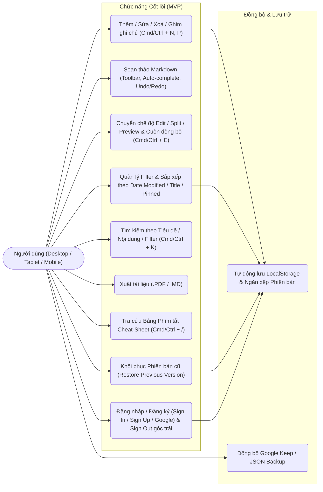
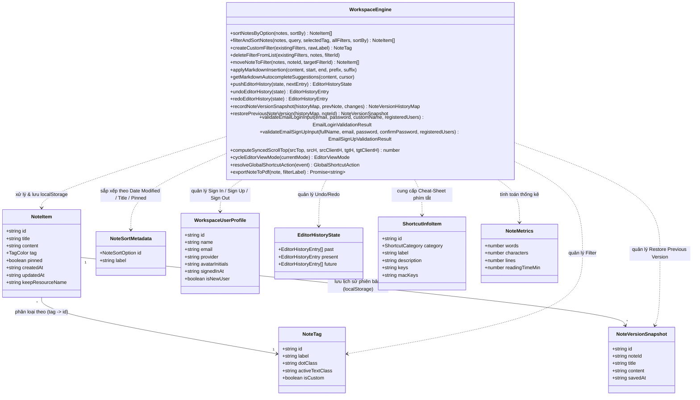

# VibeNotes — Không gian Ghi chú Kỹ thuật Markdown & Đồng bộ Google Keep

## 1. Mở đầu: Vấn đề Thực tế Cần Giải quyết (Problem Statement)

Trong công việc kỹ thuật và học tập hàng ngày, người dùng thường gặp sự phân mảnh lớn giữa hai nhóm công cụ ghi chú:
1. **Các ứng dụng ghi chú nhanh (như Google Keep, Sticky Notes)**: Mở nhanh, nhẹ, nhưng **không hỗ trợ Markdown**, không thể viết bảng biểu, checklist kỹ thuật, khối mã (`code block`), và không xuất được tài liệu PDF chỉn chu để chia sẻ.
2. **Các nền tảng quản lý tri thức đồ sộ (như Notion, Obsidian)**: Hỗ trợ Markdown mạnh mẽ nhưng thời gian khởi động chậm, giao diện nhiều tầng phức tạp, hoặc đòi hỏi cài đặt phần mềm/đồng bộ đám mây bắt buộc trước khi có thể gõ dòng đầu tiên.

**VibeNotes** được xây dựng như một **Mini-App Workspace chuyên biệt (Local-First Markdown & Keep Studio)** nhằm giải quyết bài toán thực tế đó:
- Mở trình duyệt là viết ngay lập tức với **độ trễ lưu trữ `0ms`** vào `localStorage`, kèm **hệ thống lưu lịch sử phiên bản cục bộ (`Local Note Version History` — nút `Restore previous version`)** giúp khôi phục các trạng thái nội dung trước đó ngay cả sau khi tải lại trang.
- Hỗ trợ soạn thảo Markdown tốc độ cao nhờ **thanh công cụ định dạng nổi (Floating Toolbar)** tích hợp **Undo / Redo**, **gợi ý cú pháp thông minh theo vị trí con trỏ (`/`, `#`, `-`, `>`)**, **chế độ xem song song (Split View) đồng bộ cuộn hai chiều**, và **bảng tra cứu phím tắt nhanh (Keyboard Shortcuts Cheat-Sheet Modal — `Cmd/Ctrl + /`)** cho các thao tác tạo mới (`Cmd/Ctrl + N`), chuyển chế độ xem (`Cmd/Ctrl + E`), ghim ghi chú (`Cmd/Ctrl + P`) và tìm kiếm (`Cmd/Ctrl + K`).
- **Trải nghiệm Đa thiết bị mượt mà (Notion-inspired Mobile & Tablet UX)**: Tự động thích ứng giữa giao diện **Slide-over Drawer** trên Điện thoại/Tablet (`< 1024px`) và **Docked Sidebar** trên Desktop (`>= 1024px`), thanh công cụ định dạng vuốt ngang 1 hàng (`Touch-Swipeable Toolbar`), chế độ `Split` thích ứng thông minh (chia 50/50 dọc trên Mobile, 50/50 ngang trên Tablet/Desktop), và cuộn cảm ứng quán tính mượt (`100dvh` + `smooth-touch-scroll`).
- Tổ chức ghi chú linh hoạt bằng **Filter tùy chỉnh (tạo/xoá/kéo-thả)**, **sắp xếp danh sách ghi chú trên Sidebar theo 3 chế độ (`Date Modified`, `Title`, `Pinned`)**, tìm kiếm tức thì theo **Tiêu đề / Nội dung / Filter**, **màn hình đăng nhập/đăng ký phong cách Notion (`Sign In` / `Sign Up — New User` / `Google Account`) kèm menu `Sign Out` ở góc trái màn hình**, xuất file **`.pdf` chuẩn A4** hoặc **`.md`**, và kết nối với **Google Keep** khi cần đồng bộ nhanh.

---

## 2. Mô tả Yêu cầu, Phạm vi Tối thiểu (MVP) & Sơ đồ Thiết kế

### 2.1. Lý do Chọn Phạm vi MVP (Scope Justification)
Với quỹ thời gian phát triển **1 tuần**, thay vì dàn trải vào hệ thống tài khoản backend riêng, chia sẻ thời gian thực nhiều người dùng (multi-user collaboration) hay quản lý thư mục đa cấp phức tạp, dự án tập trung tối đa vào **độ ổn định và trải nghiệm cốt lõi của cá nhân khi viết & tra cứu ghi chú trên cả Desktop, Tablet và Mobile**:
- **Ưu tiên 1 (Core CRUD, Persistence, Local Version History & Notion-Style Auth View)**: Màn hình `Sign In` / `Sign Up (New User)` / `Google Account` và menu `Sign Out` ở góc trái; thêm (`Cmd/Ctrl + N`), đọc, sửa, xoá ghi chú, ghim ghi chú (`Cmd/Ctrl + P`), tự động lưu `localStorage` và lưu ngăn xếp các phiên bản trước đó (`Restore previous version`).
- **Ưu tiên 2 (Trải nghiệm Soạn thảo Markdown, Phím tắt & Đa thiết bị)**: Thanh công cụ nhanh, Undo/Redo (`Cmd/Ctrl + Z`, `Cmd/Ctrl + Y`), gợi ý cú pháp tự động (Auto-complete), chuyển đổi chế độ xem (`Cmd/Ctrl + E`), bảng Cheat-Sheet phím tắt (`ShortcutsModal`), Split-view đồng bộ cuộn hai chiều, và bố cục Responsive chuẩn Notion cho Mobile/Tablet.
- **Ưu tiên 3 (Phân loại, Sắp xếp Đa chế độ & Tìm kiếm)**: Tạo/xoá Filter động (trừ `All`), gắn filter bằng 1 cú nhấp hoặc kéo-thả, sắp xếp danh sách ghi chú trên Sidebar theo **`Date Modified` / `Title` / `Pinned`** (`vibenotes_sort_by_v1`), tìm kiếm tức thì (`Cmd/Ctrl + K`) theo `Tiêu đề / Nội dung / Filter`.
- **Ưu tiên 4 (Trích xuất & Đồng bộ)**: Xuất file `.md`, xuất file `.pdf` định dạng A4, và tích hợp Google Keep kèm cơ chế Import/Export JSON dự phòng.

---

### 2.2. Sơ đồ Use Case Cốt lõi



---

### 2.3. Sơ đồ Lớp & Thực thể Dữ liệu (Class / ERD Diagram)



---

## 3. Đối chiếu giữa "Mục tiêu" và "Kết quả Đạt được"

| Hạng mục | Mục tiêu ban đầu (1 tuần) | Kết quả đạt được | Trạng thái |
| :--- | :--- | :--- | :--- |
| **Quản lý Ghi chú (CRUD)** | Thêm, xem, sửa, xoá (có xác nhận), ghim ghi chú ưu tiên lên đầu. | Hoạt động ổn định, phản hồi tức thì, hỗ trợ cả nút bấm lẫn phím tắt (`Cmd/Ctrl + N`, `Cmd/Ctrl + P`) và modal xác nhận xoá. | **Hoàn thành 100%** |
| **Lưu trữ Cục bộ & Lịch sử Phiên bản (`localStorage`)** | Tự động lưu ghi chú, filter, chế độ sắp xếp, theme và lưu ngăn xếp các phiên bản nội dung trước đó. | Tự động lưu với độ trễ `0ms`, kèm ngăn xếp `vibenotes_version_history_v1` (tối đa 10 bản/ghi chú) và nút **`Restore previous version`**. | **Hoàn thành 100%** |
| **Màn hình Đăng nhập / Đăng ký kiểu Notion (`LoginView`)** | Hỗ trợ `Sign In`, `Sign Up (New User)` và `Google Account` ở mức View, hiển thị tên User ở góc trái kèm nút `Sign Out` (100% tiếng Anh). | Giao diện Notion-style hỗ trợ đăng ký tài khoản mới (`vibenotes_registered_users_v1`), đăng nhập Email/Google, hiển thị tên User ở góc trái Sidebar & Footer, click mở menu **`Sign Out`**. | **Hoàn thành 100%** |
| **Trình soạn thảo Markdown & Undo/Redo** | Hỗ trợ Markdown, thanh công cụ nổi, gợi ý cú pháp tự động (`/`, `#`, `-`, `>`), Undo/Redo. | Đầy đủ Floating Toolbar, Auto-complete theo con trỏ, Undo/Redo bằng nút bấm & phím tắt (`⌘Z`/`Ctrl+Z`, `⌘⇧Z`/`Ctrl+Y`). | **Hoàn thành 100%** |
| **Bảng Tra cứu Phím tắt (`ShortcutsModal`)** | Có hộp thoại `Info` hiển thị bảng Cheat-Sheet phím tắt trực quan. | Hộp thoại `Keyboard Shortcuts Cheat-Sheet` 2 cột (`Cmd/Ctrl + /` hoặc nút `Shortcuts`), hỗ trợ đầy đủ 10 phím tắt toàn cục & trình soạn thảo. | **Hoàn thành 100%** |
| **Chế độ Xem & Đồng bộ Cuộn** | Chuyển đổi `Edit` / `Split` / `Preview` (`Cmd/Ctrl + E`), cuộn bên nào bên kia tự cuộn theo. | Đồng bộ cuộn hai chiều theo tỷ lệ phần trăm kèm khoá chống lặp sự kiện (`Anti-bounce Lock`). | **Hoàn thành 100%** |
| **Giao diện Mobile & Tablet (Notion UX)** | Hiển thị mượt trên điện thoại và máy tính bảng, không bị vỡ khung hay cuộn cứng. | Slide-over Sidebar Drawer (`< 1024px`), thanh công cụ vuốt ngang 1 hàng, Split-view 50/50 dọc (Mobile) & ngang (Tablet), cuộn mượt `100dvh`. | **Hoàn thành 100%** |
| **Hệ thống Filter, Sắp xếp Đa chế độ & Tìm kiếm** | Tạo mới filter, xoá filter (trừ `All`), sắp xếp theo **`Date Modified` / `Title` / `Pinned`**, tìm theo Tiêu đề/Nội dung/Filter. | Dropdown `Sort By` (`Date Modified`, `Title`, `Pinned`) trên Sidebar lưu bền vững vào `localStorage`, chọn filter 1 chạm hoặc kéo-thả, tìm kiếm kết hợp cả 3 trường (`Cmd/Ctrl + K`). | **Hoàn thành 100%** |
| **Xuất File (Export)** | Xuất ghi chú ra file `.md` và `.pdf` rõ nét, không lỗi font tiếng Việt. | Hỗ trợ cả `Export Markdown` và `Export PDF` chuẩn khổ A4 nhiều trang. | **Hoàn thành 100%** |
| **Đồng bộ Đám mây** | Kết nối Google Keep API + cơ chế sao lưu JSON. | Tích hợp Firebase Google OAuth + Keep REST API kèm công cụ Import/Export JSON. | **Hoàn thành 100%** |
| **Cộng tác thời gian thực (Multi-user)** | Nhiều người cùng sửa 1 ghi chú qua WebSocket. | Chưa thực hiện để tập trung độ ổn định cho Local-First MVP trong 1 tuần. | **Ngoài phạm vi (Out of Scope)** |
| **Cây thư mục lồng nhau đa cấp** | Thư mục con nhiều tầng (Sub-folders). | Giữ mô hình Filter phẳng để thao tác 1 chạm nhanh và gọn. | **Ngoài phạm vi (Out of Scope)** |
| **Đính kèm file nhị phân dung lượng lớn** | Upload video/file đính kèm nặng hàng chục MB. | Không phù hợp với giới hạn dung lượng ~5MB của `localStorage`. | **Ngoài phạm vi (Out of Scope)** |

---

## 4. Quản trị Rủi ro & Hành động Ứng phó (Risk Management)

Trong quá trình phát triển dự án trong 1 tuần, 4 rủi ro kỹ thuật và phạm vi đã được nhận diện sớm kèm giải pháp ứng phó dứt điểm:

### Rủi ro 1: Scope Creep & Mất lịch sử Undo / Phiên bản khi thao tác trên `<textarea>` có điều khiển
- **Vấn đề**: Việc tích hợp các thư viện editor đồ sộ (Monaco/ProseMirror) dễ gây xung đột state và tăng kích thước bundle; trong khi nếu dùng `<textarea>` có điều khiển bởi React state thì khi chèn cú pháp từ thanh công cụ hoặc tải lại trang (`F5`), lịch sử Undo mặc định của trình duyệt sẽ bị xoá.
- **Hành động ứng phó**: Giữ kiến trúc `<textarea>` gốc kết hợp thư viện **`marked`**, đồng thời xây dựng 2 tầng bảo vệ: (1) Ngăn xếp **`EditorHistoryState`** (`Undo`/`Redo` tức thì kèm vị trí con trỏ) và (2) Ngăn xếp **`NoteVersionHistoryMap`** lưu bền vững trong `localStorage` (`vibenotes_version_history_v1`, giới hạn `MAX_NOTE_VERSIONS = 10` bản/ghi chú để không tràn bộ nhớ) kèm nút **`Restore previous version`**.

### Rủi ro 2: Lỗi mất dấu Tiếng Việt khi xuất PDF bằng font mặc định của `jsPDF`
- **Vấn đề**: Phương thức `pdf.text()` mặc định của `jsPDF` chỉ hỗ trợ bảng mã ASCII chuẩn, dẫn đến lỗi hiển thị ký tự tiếng Việt có dấu và mất định dạng bảng biểu/code block của Markdown.
- **Hành động ứng phó**: Kết hợp **`html2canvas` + `jsPDF`** trong `src/utils/pdfExport.ts` để dựng trang tài liệu A4 chuẩn Editorial ở độ phân giải cao (`scale: 2`), sau đó phân trang tự động sang PDF, đồng thời giữ một nhánh fallback văn bản thuần khi môi trường hạn chế canvas. Giải pháp giúp giữ nguyên 100% tiếng Việt có dấu và định dạng Markdown.

### Rủi ro 3: Bố cục cứng và thanh cuộn bị xung đột trên Điện thoại & Tablet
- **Vấn đề**: Nếu giữ Sidebar cố định chiếm chỗ hoặc xếp chồng 2 cột không giới hạn chiều cao trên màn hình nhỏ (`< 768px`), vùng soạn thảo bị đẩy xuống cuối màn hình và thanh công cụ bị rớt thành nhiều dòng gây chật chội.
- **Hành động ứng phó**: Thiết kế lại theo mô hình **Notion Mobile/Tablet**: chuyển Sidebar thành ngăn kéo trượt (`Slide-over Drawer`) dưới `1024px`, thu gọn thanh công cụ định dạng thành 1 hàng vuốt ngang (`no-scrollbar`), chia đôi khung `Split` theo tỷ lệ `50/50` dọc (`grid-rows-2`) trên điện thoại và `50/50` ngang (`md:grid-cols-12`) trên máy tính bảng, đồng thời dùng `100dvh` và `overscroll-behavior-y: contain` để cuộn độc lập, mượt mà.

### Rủi ro 4: Giới hạn quyền Enterprise của Google Keep REST API đối với Gmail cá nhân
- **Vấn đề**: Scope `https://www.googleapis.com/auth/keep` của Google chỉ cấp phép mặc định cho các miền Google Workspace Enterprise, nên tài khoản `@gmail.com` cá nhân có thể bị từ chối cấp token trực tiếp.
- **Hành động ứng phó**: Thiết kế kiến trúc **Hybrid Sync** trong `GoogleKeepDrawer.tsx` — vừa hỗ trợ kết nối trực tiếp Google Keep REST API cho tài khoản Workspace, vừa bổ sung tính năng **Import / Export Keep JSON Snapshot** ngay trong ngăn kéo đồng bộ để mọi người dùng đều sao lưu và chuyển đổi dữ liệu trơn tru.

---

## 5. Tự Đánh giá (Self-Evaluation), Lessons Learned & Future Work

### 5.1. Tự Đánh giá Ngắn
- **Điểm mạnh**:
  - **Kiến trúc tách biệt & Kiểm thử đầy đủ**: Toàn bộ logic cốt lõi (đăng nhập `Sign In` / đăng ký `Sign Up` mức View kèm validation, sắp xếp ghi chú theo `Date Modified` / `Title` / `Pinned`, tìm kiếm đa trường, lọc, thống kê từ, chèn Markdown, gợi ý cú pháp, ngăn xếp Undo/Redo, ngăn xếp lịch sử phiên bản `localStorage`, tính toán vị trí cuộn đồng bộ, chuẩn hoá tên file PDF, phân giải phím tắt toàn cục) được tách thành pure functions trong `src/utils/notesLogic.ts` và được kiểm thử tự động trong thư mục **`/tests`** (**14/14** test suites gồm **10 Unit Tests**, **4 Integration Tests** và tài liệu **13 Manual Test Cases**).
  - **Trải nghiệm UX/UI nhất quán (100% English UI) trên cả Desktop, Tablet & Mobile**: Thiết kế phong cách Editorial kết hợp bố cục linh hoạt kiểu Notion, màn hình **Login / Sign Up (`LoginView.tsx` qua Email / Google Account)** hiển thị rõ tên User ở góc trái màn hình kèm menu **`Sign Out`**, dropdown sắp xếp **`Sort By` (`Date Modified`, `Title`, `Pinned`)** trên Sidebar, hộp thoại **Keyboard Shortcuts Cheat-Sheet (`ShortcutsModal`)**, nút **`Restore previous version`** và đồng bộ cuộn hai chiều mượt mà ở chế độ Split.
- **Điểm yếu**:
  - Dung lượng lưu trữ của `localStorage` giới hạn ở mức khoảng `5MB`, nên ngăn xếp phiên bản hiện giới hạn tối đa `10` bản ghi gần nhất cho mỗi ghi chú (`MAX_NOTE_VERSIONS = 10`), và hệ thống đăng nhập/đăng ký hiện đang ở mức View/Client-side (`vibenotes_user_profile_v1`, `vibenotes_registered_users_v1`) chưa kết nối cơ sở dữ liệu tài khoản đám mây.
  - Đồng bộ cuộn hai chiều hiện tính theo tỷ lệ phần trăm chiều cao tổng thể (`scrollTop / maxScroll`), có thể lệch nhẹ vài dòng nếu ghi chú chứa một bảng hoặc khối mã quá dài ở một phía.

### 5.2. Bài học Kinh nghiệm (Lessons Learned)
1. **Tách Pure Logic trước khi làm UI**: Việc viết và kiểm thử các hàm xử lý văn bản, bộ lọc, sắp xếp đa chế độ (`sortNotesByOption`), ngăn xếp Undo/Redo, lịch sử phiên bản `localStorage`, xác thực đăng nhập/đăng ký và phân giải phím tắt trong `notesLogic.ts` giúp phát hiện sớm các trường hợp biên (như xoá ghi chú thì tự động dọn sạch lịch sử phiên bản của ghi chú đó, hoặc sắp xếp theo `Title` không phân biệt hoa thường và nhận diện số tự nhiên).
2. **Thiết kế Responsive ưu tiên cảm ứng (Touch-First Adaptation)**: Trên thiết bị di động, việc ẩn các nút thao tác sau `hover` hoặc để thanh công cụ tự xuống dòng sẽ làm giảm mạnh diện tích soạn thảo; sử dụng ngăn kéo trượt và thanh công cụ vuốt ngang 1 hàng giúp giữ trọn không gian viết.

### 5.3. Hướng Phát triển Tiếp theo nếu có thêm 1 tuần (Future Work)
Nếu có thêm **1 tuần** phát triển, dự án sẽ ưu tiên nâng cấp theo thứ tự sau:
1. **Chuyển tầng lưu trữ sang `IndexedDB` kèm Diff Viewer**: Mở rộng dung lượng lưu trữ cục bộ từ `5MB` lên hàng trăm MB và hiển thị giao diện so sánh trực quan (Side-by-side Diff) giữa các phiên bản trong lịch sử trước khi nhấn `Restore`.
2. **Đồng bộ cuộn theo mốc dòng (Line-Map Scroll Sync)**: Gắn thuộc tính `data-source-line` vào từng khối HTML do `marked` sinh ra để đồng bộ vị trí cuộn chính xác tuyệt đối theo từng đoạn văn/tiêu đề.
3. **Tuỳ biến Phím tắt Cá nhân (Customizable Keybindings)**: Cho phép người dùng tuỳ chỉnh lại các tổ hợp phím ngay trong `ShortcutsModal` và lưu cấu hình vào `localStorage`.

---

## 6. Cấu trúc Tài liệu, Tiến độ (`/docs`) & Kiểm thử (`/tests`)

Toàn bộ tài liệu kiến trúc, bảng phân rã công việc (WBS), nhật ký tiến độ hàng ngày và bộ kiểm thử được đóng gói gọn gàng theo cấu trúc sau:

- **[`DECISIONS.md`](DECISIONS.md)**: Tài liệu quyết định kiến trúc & lựa chọn công nghệ (ADR).
- **Thư mục [`/docs`](docs/)**: Đóng gói toàn bộ file ghi log và kế hoạch tiến độ dự án:
  - **[`docs/PROJECT_PLAN_WBS.md`](docs/PROJECT_PLAN_WBS.md)**: Bảng phân rã công việc (WBS), mốc thời gian 7 ngày và Định nghĩa hoàn thành (Definition of Done - DoD).
  - **[`docs/PROJECT_PLAN_WBS.csv`](docs/PROJECT_PLAN_WBS.csv)**: File CSV tiến độ.
  - **[`docs/DAILY_LOG.md`](docs/DAILY_LOG.md)**: Nhật ký công việc hàng ngày (Daily Standup Log: hôm qua làm gì, hôm nay làm gì, vướng mắc & hướng xử lý, kèm commit message).
- **Thư mục [`/tests`](tests/)**: Bộ kiểm thử tự động & thủ công:
  - **[`tests/unit/notesLogic.unit.test.ts`](tests/unit/notesLogic.unit.test.ts)**: 10 Unit Test Suites cho các hàm xử lý logic chính.
  - **[`tests/integration/workspaceFlow.integration.test.ts`](tests/integration/workspaceFlow.integration.test.ts)**: 4 Integration Test Suites kiểm tra luồng nghiệp vụ đầu-cuối.
  - **[`tests/MANUAL_TEST_CASES.md`](tests/MANUAL_TEST_CASES.md)**: Bảng 13 kịch bản kiểm thử thủ công (`TC-01` $\rightarrow$ `TC-13`).

### Lệnh Chạy Dự án & Kiểm thử

```bash
# 1. Cài đặt dependencies
npm install

# 2. Chạy ứng dụng ở môi trường phát triển (Port 3000)
npm run dev

# 3. Chạy toàn bộ bộ kiểm thử tự động (14/14 Unit & Integration Tests trong thư mục /tests)
npm test

# 4. Kiểm tra biên dịch TypeScript & Build Production
npm run build
```

