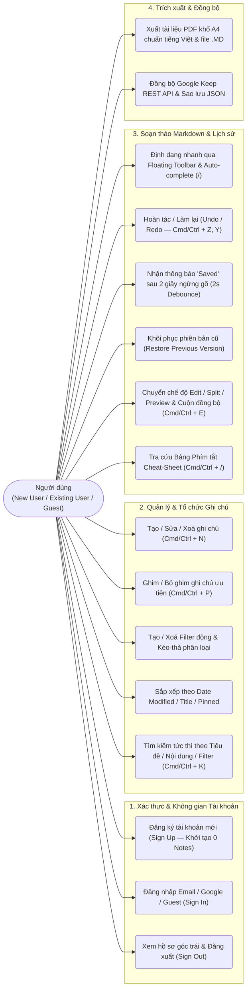
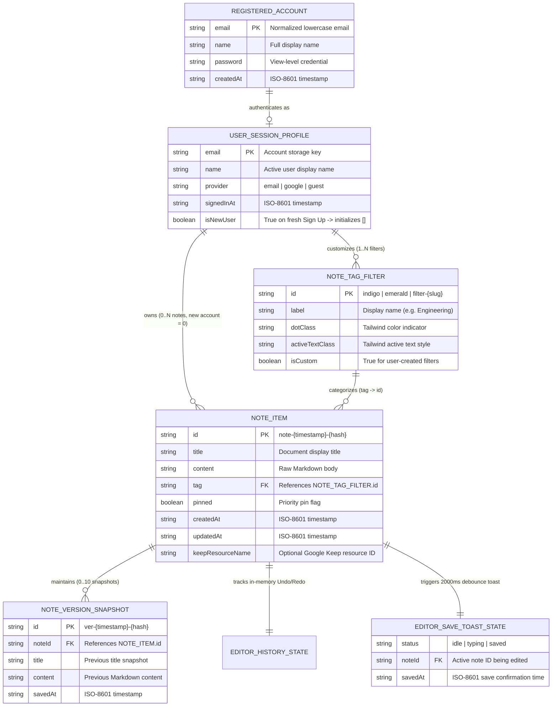
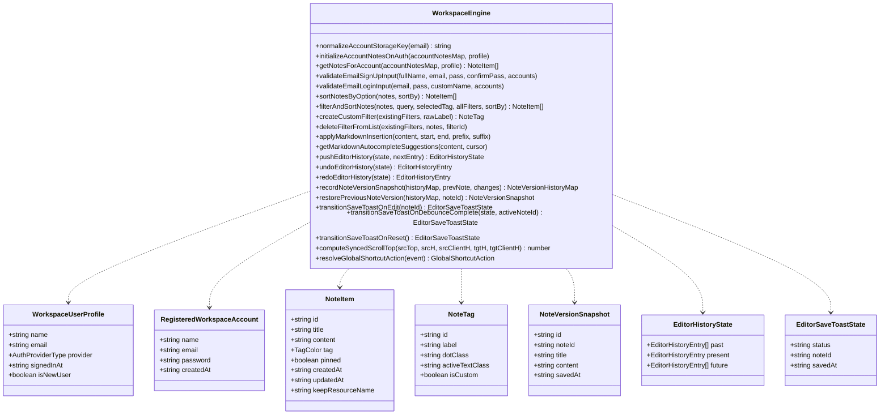
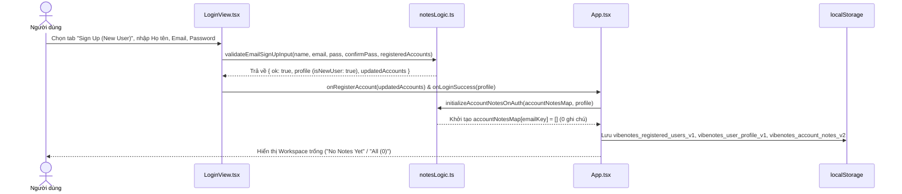
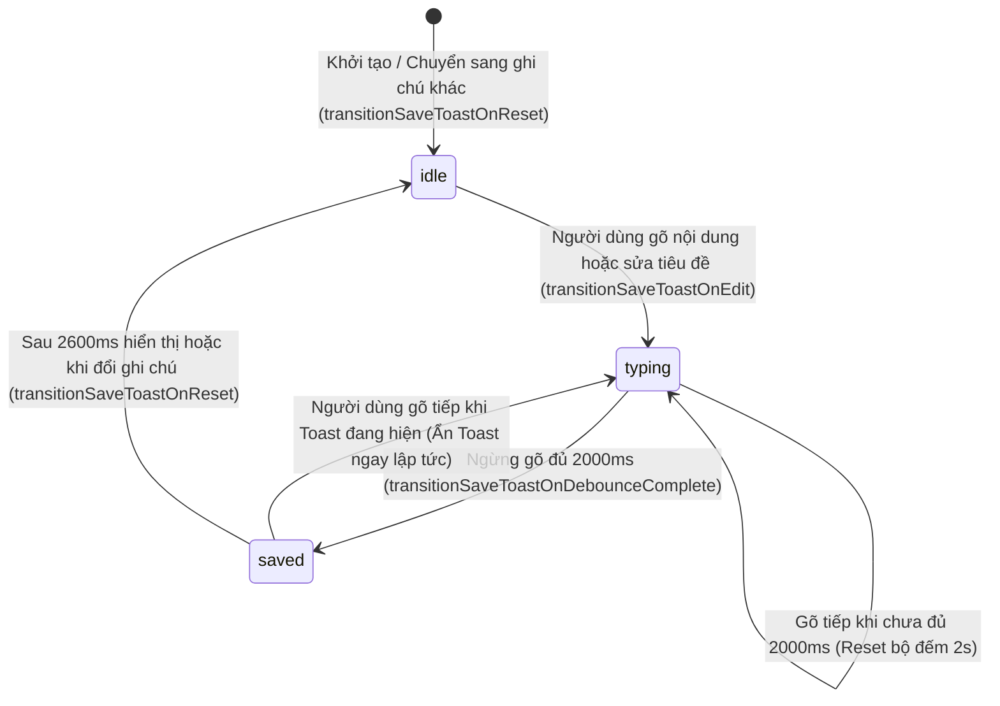

# 2. Tài liệu Kỹ thuật & Kiến trúc Hệ thống (Technical & Architecture Documentation)

Dự án: **VibeNotes — Không gian Ghi chú Kỹ thuật Markdown & Đồng bộ Google Keep**  
Phiên bản Kiến trúc: **2.0 (Local-First Per-Account Workspace)**  
Vị trí lưu trữ: **`/docs/TECHNICAL_DOCUMENTATION.md`**

> **Liên kết Hệ thống Tài liệu Dự án (4 Phần)**:
> 1. **Tổng quan Dự án & Kế hoạch Tiến độ**: [`/README.md`](../README.md) · [`/docs/PROJECT_PLAN_WBS.md`](./PROJECT_PLAN_WBS.md) · [`/docs/DAILY_LOG.md`](./DAILY_LOG.md)
> 2. **Tài liệu Kỹ thuật & Kiến trúc (File này)**: [`/docs/TECHNICAL_DOCUMENTATION.md`](./TECHNICAL_DOCUMENTATION.md) · [`/DECISIONS.md`](../DECISIONS.md)
> 3. **Tài liệu Hướng dẫn Sử dụng & Quản trị (User Manual & Admin Guide)**: [`/docs/USER_MANUAL_ADMIN_GUIDE.md`](./USER_MANUAL_ADMIN_GUIDE.md)
> 4. **Tài liệu Kiểm thử & Đảm bảo Chất lượng (Testing & QA)**: [`/tests/MANUAL_TEST_CASES.md`](../tests/MANUAL_TEST_CASES.md)

---

## 1. Sơ đồ Kiến trúc Tổng quan Hệ thống (High-Level System Architecture)

**VibeNotes** được thiết kế theo kiến trúc **Client-Side Local-First SPA (Single-Page Application)** tách biệt hoàn toàn giữa **Tầng Giao diện (Presentation Layer)**, **Tầng Xử lý Nghiệp vụ Thuần túy (Pure Domain & State Engine Layer)** và **Tầng Lưu trữ & Tích hợp Ngoài (Persistence & External Integration Layer)**.

```mermaid
flowchart TB
    subgraph Client["Trình duyệt Người dùng (Desktop / Tablet / Mobile - 100dvh)"]
        subgraph UI["1. Tầng Giao diện (Presentation Layer - React 19 + Tailwind CSS v4)"]
            LoginUI["LoginView.tsx\n(Notion-Style Sign In / Sign Up / Google / Guest)"]
            HeaderUI["App Header & Footer\n(Navigation, Theme Toggle, Left-Corner Sign Out)"]
            SidebarUI["Sidebar.tsx\n(Search ⌘K, Sort By Dropdown, Dynamic Filters, Note Cards)"]
            EditorUI["NoteWorkspace.tsx\n(Floating Toolbar, Auto-complete, Split Scroll Sync, 'Saved' Toast)"]
            ModalsUI["Modals & Drawers\n(ShortcutsModal, ConfirmDialog, GoogleKeepDrawer)"]
        end

        subgraph Engine["2. Tầng Nghiệp vụ Thuần túy (Pure Logic Layer - src/utils/)"]
            AuthLogic["Account & Auth Engine\n(validateEmailSignUpInput, validateEmailLoginInput,\nnormalizeAccountStorageKey, initializeAccountNotesOnAuth)"]
            NoteLogic["Note, Filter & Sort Engine\n(createNewNoteItem, filterAndSortNotes,\nsortNotesByOption, createCustomFilter, deleteFilterFromList)"]
            MarkdownLogic["Markdown & History Engine\n(marked Parser, applyMarkdownInsertion,\ngetMarkdownAutocompleteSuggestions, Undo/Redo Stack)"]
            VersionToastLogic["Version History & Save Toast State Machine\n(recordNoteVersionSnapshot, restorePreviousNoteVersion,\nEditorSaveToastState — 2000ms Debounce)"]
            PdfEngine["PDF & Print Engine\n(pdfExport.ts — html2canvas + jsPDF A4 Unicode)"]
        end

        subgraph Storage["3. Tầng Lưu trữ Cục bộ Cô lập theo Tài khoản (Browser LocalStorage)"]
            LS_Users[("vibenotes_registered_users_v1\nvibenotes_user_profile_v1")]
            LS_Notes[("vibenotes_account_notes_v2\n(Keyed by normalized email — New Account = [])")]
            LS_Filters[("vibenotes_account_filters_v2\nvibenotes_sort_by_v1")]
            LS_Versions[("vibenotes_account_version_history_v2\n(Max 10 snapshots / note)")]
        end
    end

    subgraph Cloud["4. Dịch vụ Đám mây Tích hợp (External Cloud Services)"]
        FirebaseAuth["Firebase Authentication\n(Google OAuth 2.0 Popup)"]
        KeepAPI["Google Keep REST API\n(https://keep.googleapis.com/v1/notes)"]
    end

    LoginUI --> AuthLogic
    SidebarUI --> NoteLogic
    EditorUI --> MarkdownLogic
    EditorUI --> VersionToastLogic
    EditorUI --> PdfEngine
    HeaderUI --> AuthLogic

    AuthLogic <--> LS_Users
    AuthLogic <--> LS_Notes
    NoteLogic <--> LS_Notes
    NoteLogic <--> LS_Filters
    VersionToastLogic <--> LS_Versions

    ModalsUI <--> FirebaseAuth
    ModalsUI <--> KeepAPI
```



---

## 2. Sơ đồ Use Case Tổng thể (System Use Case Diagram)



---

## 3. Mô hình Cơ sở Dữ liệu & Lược đồ Thực thể (ERD & Class Diagram)

### 3.1. Sơ đồ Quan hệ Thực thể Dữ liệu (Entity-Relationship Diagram - ERD)

Mặc dù sử dụng `localStorage` để đạt độ trễ `0ms`, dữ liệu của **VibeNotes** được chuẩn hoá chặt chẽ theo mô hình quan hệ thực thể cô lập theo từng tài khoản (`account_key = normalizeAccountStorageKey(email)`):



---

### 3.2. Sơ đồ Lớp Chi tiết (Detailed Class Diagram)



---

### 3.3. Bảng Đặc tả Lược đồ Lưu trữ `localStorage` (Storage Keys Specification)

| Khóa `localStorage` (Key) | Kiểu Dữ liệu (TypeScript Type) | Phạm vi (Scope) | Mô tả Chi tiết & Cơ chế Khởi tạo |
| :--- | :--- | :--- | :--- |
| `vibenotes_user_profile_v1` | `WorkspaceUserProfile \| null` | Toàn cục (Phiên hiện tại) | Lưu thông tin người dùng đang đăng nhập (`name`, `email`, `provider`, `isNewUser`). Xoá khi nhấn `Sign Out`. |
| `vibenotes_registered_users_v1` | `RegisteredWorkspaceAccount[]` | Toàn cục | Danh sách các tài khoản đã đăng ký qua tab `Sign Up (New User)` để kiểm tra trùng email và xác thực mật khẩu khi `Sign In`. |
| `vibenotes_account_notes_v2` | `Record<string, NoteItem[]>` | **Theo từng Account (`email`)** | Ánh xạ từ email chuẩn hoá (`normalizeAccountStorageKey`) sang mảng ghi chú riêng của tài khoản đó. **Tài khoản mới luôn khởi tạo là `[]` (`0` ghi chú)**. |
| `vibenotes_account_filters_v2` | `Record<string, NoteTag[]>` | **Theo từng Account (`email`)** | Ánh xạ từ email chuẩn hoá sang danh sách Filter của tài khoản đó (mặc định khởi tạo từ `TAG_CATEGORIES`). |
| `vibenotes_account_version_history_v2` | `Record<string, NoteVersionHistoryMap>` | **Theo từng Account (`email`)** | Lưu ngăn xếp tối đa `10` phiên bản cũ (`MAX_NOTE_VERSIONS = 10`) cho mỗi ghi chú thuộc tài khoản đang đăng nhập. |
| `vibenotes_sort_by_v1` | `'pinned' \| 'dateModified' \| 'title'` | Toàn cục | Lưu chế độ sắp xếp danh sách ghi chú trên Sidebar (`Pinned`, `Date Modified`, `Title`). |
| `vibenotes_theme_v2` | `'light' \| 'dark'` | Toàn cục | Lưu giao diện Sáng (`#f8f7f4`) hoặc Tối (`#121210`). |

---

## 4. Sơ đồ Luồng Hoạt động & Máy Trạng thái (Sequence & State Diagrams)

### 4.1. Luồng Đăng ký Tài khoản Mới (`0 Notes`) & Cô lập Dữ liệu theo Tài khoản



---

### 4.2. Máy Trạng thái Thông báo `'Saved'` sau 2 giây ngừng gõ (`2000ms` Debounce)



---

### 4.3. Luồng Đồng bộ Cuộn Hai chiều ở Chế độ `Split` (Bidirectional Scroll Sync)

```mermaid
sequenceDiagram
    actor User as Người dùng
    participant Editor as Khung Soạn thảo (<textarea>)
    participant Logic as computeSyncedScrollTop()
    participant Preview as Khung Xem trước (Live Preview)

    User->>Editor: Cuộn chuột / Vuốt cảm ứng trên khung Edit
    Editor->>Editor: Kiểm tra activeScrollSourceRef !== 'preview'
    Editor->>Editor: Khoá nguồn cuộn activeScrollSourceRef = 'editor'
    Editor->>Logic: computeSyncedScrollTop(srcTop, srcScrollH, srcClientH, tgtScrollH, tgtClientH)
    Logic-->>Editor: Trả về vị trí nextScrollTop theo tỷ lệ %
    Editor->>Preview: Gán previewEl.scrollTop = nextScrollTop
    Note over Editor,Preview: Khoá activeScrollSourceRef giữ trong 60ms để chặn sự kiện onScroll dội ngược
```



---

## 5. Cấu trúc Thư mục Mã nguồn (Source Code Directory Structure)

```text
/
├── index.html                                # Entry HTML (Fonts: Cormorant Garamond, DM Sans, Space Mono)
├── metadata.json                             # Cấu hình metadata ứng dụng
├── package.json                              # Dependencies & scripts (dev, build, test, lint)
├── DECISIONS.md                              # Hồ sơ quyết định kiến trúc (ADR)
├── README.md                                 # Tài liệu tổng quan dự án (File 1)
├── docs/                                     # Thư mục đóng gói tài liệu dự án
│   ├── TECHNICAL_DOCUMENTATION.md            # Tài liệu Kỹ thuật & Kiến trúc (File 2)
│   ├── USER_MANUAL_ADMIN_GUIDE.md            # Tài liệu Hướng dẫn Sử dụng & Quản trị (File 3)
│   ├── PROJECT_PLAN_WBS.md                   # Bảng phân rã công việc (WBS 7 ngày)
│   ├── PROJECT_PLAN_WBS.csv                  # File CSV tiến độ dùng cho Excel / Notion
│   └── DAILY_LOG.md                          # Nhật ký tiến độ hàng ngày (Daily Standup Log)
├── src/
│   ├── main.tsx                              # Điểm khởi chạy ứng dụng React 19
│   ├── App.tsx                               # Quản lý state theo tài khoản, phím tắt toàn cục & bố cục chính
│   ├── index.css                             # Hệ thống Design Tokens (Light/Dark theme) & Smooth Touch Scroll
│   ├── components/
│   │   ├── LoginView.tsx                     # Màn hình Sign In / Sign Up (New User) / Google / Guest kiểu Notion
│   │   ├── Sidebar.tsx                       # Thanh bên: Hồ sơ User góc trái, Search, Sort By, Filters, Note Cards
│   │   ├── NoteWorkspace.tsx                 # Trình soạn thảo Markdown, Floating Toolbar, Toast 'Saved' (2s), Split View
│   │   ├── ShortcutsModal.tsx                # Hộp thoại tra cứu 10 phím tắt (Cheat-Sheet 2 cột)
│   │   ├── GoogleKeepDrawer.tsx              # Ngăn kéo đồng bộ Google Keep REST API & Import/Export JSON
│   │   └── ConfirmDialog.tsx                 # Hộp thoại xác nhận thao tác xoá an toàn
│   ├── services/
│   │   └── keepService.ts                    # Dịch vụ kết nối Firebase Auth & Google Keep REST API
│   └── utils/
│       ├── notesLogic.ts                     # Toàn bộ hàm thuần túy (Pure Functions) xử lý nghiệp vụ cốt lõi
│       └── pdfExport.ts                      # Bộ kết xuất PDF khổ A4 chuẩn Unicode tiếng Việt (html2canvas + jsPDF)
└── tests/                                    # Bộ kiểm thử tự động & thủ công (File 4)
    ├── MANUAL_TEST_CASES.md                  # 14 kịch bản kiểm thử thủ công (TC-01 -> TC-14)
    ├── unit/
    │   └── notesLogic.unit.test.ts           # 12 Unit Test Suites kiểm thử toàn bộ hàm trong notesLogic.ts
    └── integration/
        └── workspaceFlow.integration.test.ts # 4 Integration Test Suites kiểm thử luồng nghiệp vụ đầu-cuối
```
